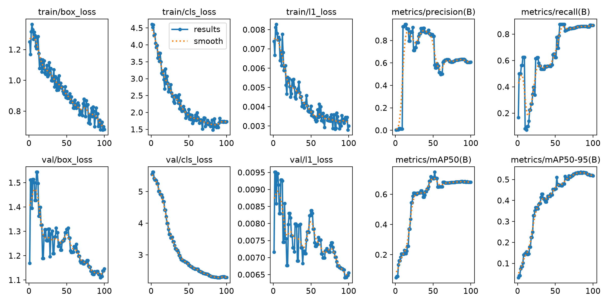

# Mogadishu Traffic — ANPR & Traffic Analytics

Automatic license plate recognition and traffic analytics for street video.
A YOLO detector locates vehicles, bajajaj , people and license
plates; ByteTrack keeps identities stable across frames; EasyOCR reads the plate
text; and the pipeline annotates an output video with plates, speeds and live
counters.



## Features

- **Detection** — custom YOLO model with 4 classes: `bajaaj`, `license_plate`, `person`, `vehicle`
- **Tracking** — ByteTrack assigns persistent IDs so plates stay attached to their vehicle
- **Class voting** — a track's class is resolved by accumulated confidence, with a priority tie-break
- **OCR** — multi-pass EasyOCR (original / grayscale / Otsu) with Somali-plate aware character correction
- **Plate voting** — the best read per track is chosen by confidence weighted by how often it appeared
- **Plate → vehicle association** — plates are linked to the vehicle box that contains (or is nearest to) them
- **Speed estimation** — per-track km/h from a 30-frame position history, exponentially smoothed
- **Annotated output** — colored boxes, plate text, speed labels and on-screen counters written to `output.mp4`
- **Console report** — unique counts per class and a per-vehicle table (ID, type, plate, speed, OCR confidence)

## Requirements

- Python >= 3.14 (see `.python-version`)
- Dependencies: `ultralytics`, `easyocr` (OpenCV and PyTorch come in transitively)
- A trained checkpoint at `./models/train/weights/best.pt`
- A video to process (default `./mogadishu_traffic_25s.mp4`)

## Installation

The project uses [uv](https://docs.astral.sh/uv/):

```bash
uv sync
```

Or with plain pip:

```bash
pip install -e .
```

## Usage

### Run inference + annotation

```bash
uv run python app.py
```

Reads `config.video_path`, writes `config.output_path` (`output.mp4`) and prints
the OCR log, class counters and a per-vehicle summary.

### Train the detector

```bash
uv run python main.py
```

Trains `yolo26n.pt` for 100 epochs at `imgsz=640`, `batch=8`, writing runs to
`./models`. Results, curves and weights land in `models/train/`.

> `data.yaml` currently points at absolute Linux paths. Update `train`, `val`
> and `test` to match your dataset layout before training elsewhere.

## Configuration

Everything tunable lives in `config.py`:

| Field | Default | Purpose |
| --- | --- | --- |
| `model_path` | `./models/train/weights/best.pt` | Detector checkpoint |
| `video_path` | `./mogadishu_traffic_25s.mp4` | Input video |
| `output_path` | `./output.mp4` | Annotated output video |
| `ocr_interval` | `5` | Run OCR every N frames per plate |
| `ocr_languages` | `("en",)` | EasyOCR languages |
| `non_plate_display_seconds` | `1.0` | How long class/ID labels stay on new tracks |
| `plate_grace_seconds` | `0.5` | How long a last-known plate stays on screen after its track ends |
| `min_confidence` | `0.5` | Detector confidence threshold |
| `iou_suppress` | `0.45` | NMS IoU for cross-class overlap suppression |
| `pixels_per_meter` | `45.0` | Scale used to convert pixels to meters for speed |
| `class_names` | see above | class id → name |
| `class_priority` | plate > bajaaj > vehicle > person | Tie-break and overlap-suppression order |

`pixels_per_meter` is camera dependent — recalibrate it for each new camera or
the speed numbers will be wrong.

## Project layout

```
app.py                 inference entry point
main.py                training entry point
config.py              all settings in one frozen dataclass
data.yaml              YOLO dataset config (4 classes)
anpr/
  pipeline.py          frame loop: detect → track → suppress → associate → draw
  tracker.py           track lifecycle, class voting, plate voting, plate↔vehicle links
  ocr.py               EasyOCR wrapper, normalization, plate correction, voting
  geometry.py          IoU and priority-aware overlap suppression
  speed.py             per-track speed estimation and smoothing
  renderer.py          OpenCV drawing helpers
models/train/          training artifacts and weights
```

## How it works

1. `YOLO.track(..., tracker="bytetrack.yaml", persist=True)` yields boxes with
   track IDs.
2. `suppress_overlapping` drops lower-priority boxes (e.g. `person`) that sit on
   top of a `license_plate` box above the IoU threshold.
3. `TrackManager.observe` accumulates confidence votes per class and resolves the
   track's class, breaking near-ties with `class_priority`.
4. Every `ocr_interval` frames, each plate crop is padded, upscaled 4× and read in
   three variants; valid reads are stored per track.
5. `vote_best` picks the winning plate string (confidence boosted by repeat count).
6. `associate_plates` links each plate track to the vehicle box containing its
   centre, else the nearest one within 200 px.
7. `SpeedEstimator` converts the centre-pixel displacement over the last 30 frames
   into km/h and smooths it.
8. `renderer` draws boxes, labels and counters; the frame is written to the output
   video.

## Notes and limitations

- Speed accuracy depends entirely on `pixels_per_meter` and constant camera
  position; it is an image-plane estimate, not a radar measurement.
- Plate correction maps lookalike letters to digits (`O→0`, `I→1`, `S→5`, …) and
  normalizes `A0`/`AE` prefixes — tuned for Somali plates.
- OCR runs three EasyOCR passes per plate crop, which is the main cost. Increase
  `ocr_interval` for faster playback.
- Outputs (`output.mp4`, `runs/`, `__pycache__/`) are not tracked by git.

## License

This project is licensed under the Apache License 2.0. See the LICENSE file for details.